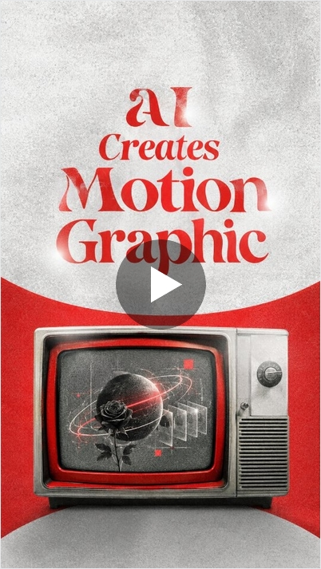
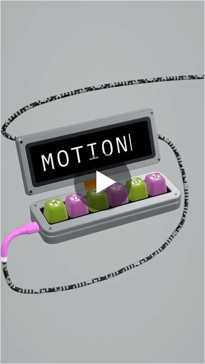
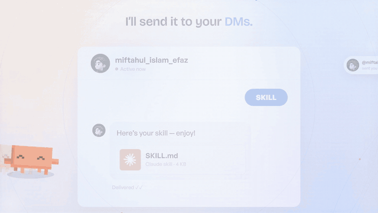

<div align="center">

# Motion Video Director

**A Claude Code skill for motion graphics and video editing.**

Plan, animate, edit, voice and sound-design complete videos with Claude Code, Codex or Cursor. Everything renders locally, with no After Effects or Premiere.


<sub>Every frame above was written and rendered by Claude Code using this skill.</sub>

</div>

## Latest version — 3.5.2

Claude-compatible packaging and setup safety improvements, retaining all 3.5.1 helper fixes below.

- Valid YAML frontmatter with a shorter description and a host-specific installation guide.
- Safer MCP/credential setup: dotenv files are data, not shell scripts; existing credentials are preserved by default.
- Unique preview caches, no review-clip overwrites, input validation, configured FFmpeg support and nonzero exit status on MP4 failure.
- 22 automated checks passed on Windows with synthetic test media, plus archive integrity/layout checks. Live Claude upload, paid API calls and other operating systems were not tested.

**Download:** [Claude Code plugin ZIP](https://github.com/Miftahul-Islam-Efaz/Motion-graphics-skill/releases/download/v3.5.2/Motion_Video_Director_v3.5.2_Claude_Code_Plugin.zip). This is a plugin package, not a direct Claude app custom-skill ZIP. See [installation and host limits](skills/motion-video-director/reference/installation.md).

### Previous release fixes — 3.5.1

Portable on-demand guides, local audio analysis and consent-gated ElevenLabs SFX generation, plus the helper fixes reported in [PR #2](https://github.com/Miftahul-Islam-Efaz/Motion-graphics-skill/pull/2). Thanks to **@Aliang-CN** for the detailed bug report, fixes and render-starter proposal. The equivalent fixes are implemented in the newer cross-platform helpers rather than merging older helper code.

- Accurate preview timestamps and explicit audio inputs.
- Reference analysis refreshes old generated outputs, groups 30 frames per sheet and clearly skips audio for silent references.
- Setup inventory checks runtime versions and selected Playwright/Chromium file availability; a smoke test still checks actual rendering.
- Ready-to-copy deterministic rendering starter at `skills/motion-video-director/templates/render/`.
- No SFX collection, model weights, private credentials or customer project files are bundled.

## Overview

Motion Video Director turns a coding agent into a video production team. It handles the work a motion designer, editor and sound designer would normally do:

- Motion graphics and animated explainers, drawn in code (Canvas, SVG, Three.js, GSAP)
- Editing raw footage and talking-head clips: cuts, punch zooms, captions, B-roll, text behind the subject
- Voiceover scripts for ElevenLabs, with word-level timing for every shot
- Sound design synced to the frame and mixed to platform loudness (-14 LUFS)
- Final MP4 renders in 9:16, 16:9 or 1:1

The skill is a production playbook (`SKILL.md`) plus a set of helper scripts. The agent follows a fixed process with approval gates, so you review the script, the plan and a preview before anything is fully rendered.

## Examples

All of these were made with this skill.

| AI Creates Motion Graphic | Motion keyboard | Brud Code launch |
|:---:|:---:|:---:|
| [](https://www.instagram.com/reel/DeImcItix7Z/) | [](https://www.instagram.com/reel/DeH5WTZgSmX/) | [](https://www.instagram.com/reel/Dd54bw2J5bc/) |
| [Watch on Instagram](https://www.instagram.com/reel/DeImcItix7Z/) | [Watch on Instagram](https://www.instagram.com/reel/DeH5WTZgSmX/) | [Watch on Instagram](https://www.instagram.com/reel/Dd54bw2J5bc/) |

The launch ad for this skill was also produced with it: a 56-second, 1080p SaaS ad with voiceover, 2D/3D animation and a full sound mix.

<div align="center">

</div>

## Installation

### Quick install (recommended)

Run this in your project folder. It works with Claude Code, Codex, Cursor and other agents that support skills:

```bash
npx skills add Miftahul-Islam-Efaz/Motion-graphics-skill
```

You need Node.js installed. The installer asks which agent you use and copies the skill to the right folder.

### Claude Code plugin

Inside Claude Code, run:

```text
/plugin marketplace add Miftahul-Islam-Efaz/Motion-graphics-skill
/plugin install motion-video-director@motion-graphics-skill
```

Restart Claude Code afterwards.

### Manual install

1. Click **Code → Download ZIP** at the top of this page and unzip it.
2. Copy the `skills/motion-video-director` folder into one of these locations:
   - `~/.claude/skills/` to use it in every project (on Windows: `C:\Users\<you>\.claude\skills\`)
   - `.claude/skills/` inside a project to use it only there
3. Restart Claude Code.

For Codex, Cursor or other agents, copy the folder into your project and tell the agent:

```text
Read skills/motion-video-director/SKILL.md and follow it for this video project.
```

## Usage

Describe the video you want and attach references if you have them.

```text
Make a 30-second 9:16 launch reel for my SaaS. References attached.
```

```text
Edit my raw talking-head clip into a reel with captions, punch zooms and B-roll.
```

```text
Create a 45-second product explainer of our dashboard. Clean UI animation, subtle sound design.
```

The agent then works through these steps:

1. **Brief.** Collects references, story, audience, format and length.
2. **Voiceover script.** Writes a script ready to paste into ElevenLabs. You generate the MP3 and send it back.
3. **Storyboard.** Times every shot to the words in the voiceover.
4. **Build.** Animates the scenes in code and edits any footage you provided.
5. **Preview.** Renders contact sheets of each scene and fixes problems before the full render.
6. **Render and mix.** Exports the final video with sound design and loudness normalization, then runs a QA checklist.

You approve the script, the plan and the preview before the final render. Progress is logged in `PROGRESS.md`, so a new session can continue where the last one stopped.

## What the skill covers

| Area | Details |
|---|---|
| Directing | Hooks in the first 3 seconds, pacing, shot types, J/L cuts, match cuts, CTA structure |
| Editing intensity | Five levels, from fast-paced reels to restrained corporate video |
| Motion graphics | Kinetic typography, 3D text, UI mockups, cursor animation, stickers, particles, Lottie |
| Footage editing | Punch zooms, subject cutouts (RVM, SAM2), captions behind the subject, speed ramps |
| 3D | Three.js product shots, floating cards, camera fly-throughs, extruded logos |
| Animation | The 12 principles of animation, easing, staggering, overshoot |
| Color and layout | 60-30-10 color, WCAG contrast, safe zones for 9:16 platforms |
| Sound | Risers, impacts and whooshes synced to the frame, ducking under voice, -14 LUFS / -1.5 dBTP |
| Voiceover | ElevenLabs scripting, audio QA, word timestamps with faster-whisper |
| Assets | Fonts, sound effects and stock footage via Firecrawl, Freesound, Pixabay, Unsplash and LottieFiles. The agent can also browse sites like Pinterest and Behance with Playwright |

## Repository structure

```text
.claude-plugin/
  plugin.json            Plugin manifest
  marketplace.json       Marketplace entry for one-command install
skills/motion-video-director/
  SKILL.md               The production playbook
  config.example.json    Optional project-local path configuration
  LICENSE.md             Skill licence
  reference/             On-demand production, setup, audio and delivery guides
  scripts/
    preflight.py         Read-only tool/version and browser-file inventory
    preflight.sh         Compatibility wrapper for preflight.py
    preview.mjs          Range preview, contact sheet and optional audio clip
    analyze_ref.py       Refreshable reference frames, cuts and optional audio
    analyze_ref.sh       Compatibility wrapper for analyze_ref.py
    create_env.py        Creates empty key slots without exposing values
    create_env.sh        Legacy shell entrypoint retained
    normalize_env.py     Converts an existing key file into a clean .env
    ...                  Local audio, procedural SFX and consent-gated API helpers
  templates/
    render/              Deterministic Canvas/Playwright rendering starter
    TASTE.md             Project-specific visual and sound direction
    design.html          Design review starter
```

## Requirements

Core helpers: Python 3.10+, FFmpeg and ffprobe. Browser rendering additionally uses Node.js 18+ and compatible Playwright/Chromium. Reuse installed tools; ask before installing or downloading anything. Pillow provides reference-sheet labels; FFmpeg provides an explicitly unlabelled fallback, so ImageMagick is optional.

Optional: Python packages such as `faster-whisper`, `rembg` and `demucs` for transcription, cutouts and stem separation; NumPy/SciPy and librosa/soundfile for local audio work. CLAP/PANNs are optional; CoNeTTE is experimental/manual, not a required tested integration. You can also add API keys or MCP servers for Firecrawl, Freesound, Pixabay, Unsplash and LottieFiles.

To see what is installed and what is missing, run:

```bash
python "skills/motion-video-director/scripts/preflight.py"
```

API keys are stored in a local `.env` file, which is excluded from git.

The inventory makes no installs/downloads and does not launch a browser. Browser-file presence is not a successful launch test. For a new project, copy `templates/render/` into project `src/` (never overwrite an existing renderer), set package.json `"type":"module"`, and run the smoke test in `reference/planning-and-tracking.md`. Use `--mp4 --audio <mix.wav>` for a preview with sound; `--mp4` alone is silent. No paid API call is needed for rendering.

### Licence and validation
See [LICENSE.md](LICENSE.md) for the skill licence; third-party assets/providers have separate terms. [RELEASE_CHECKS.json](RELEASE_CHECKS.json) records the validation scope. The helper regression suite passed on Windows with synthetic media; full macOS rendering and model inference are not claimed tested.

## FAQ

**Do I need After Effects or Premiere Pro?**
No. Animation is written in code and rendered with headless Chrome and ffmpeg.

**Can it edit existing footage, or only create animation?**
Both. It can cut, caption, grade and sound-design raw clips, and combine them with motion graphics.

**What does it cost to run?**
Rendering is free and local. ElevenLabs and some stock-media APIs have their own pricing; their free tiers cover most projects.

**Does it work outside Claude Code?**
Yes. It works with any agent that can run terminal commands and edit files, including Codex and Cursor.

## Author

Made by [Miftahul Islam Efaz](https://www.instagram.com/miftahul_islam_efaz/). If you make something with it, tag me on Instagram.

© 2026 Miftahul Islam Efaz. All rights reserved.
